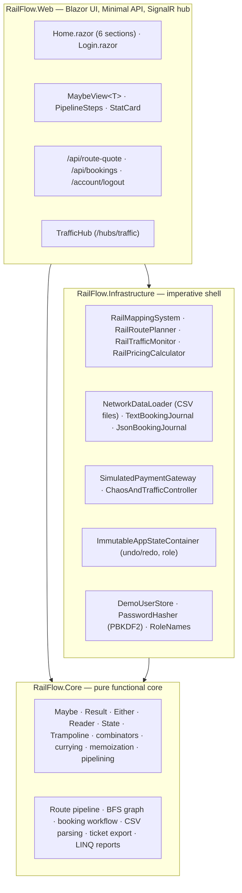
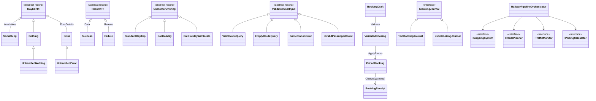
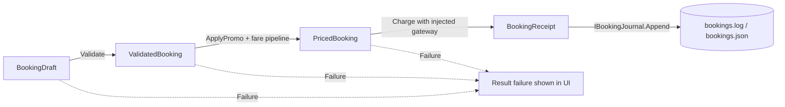

# RailFlow — Rail Route, Pricing & Booking App in Blazor and Functional C#

RailFlow plans train journeys across a European rail network, prices them, books tickets and keeps a booking history on disk.
It is a **.NET 10 Blazor Server** app built as a **functional core with an imperative shell**: all business rules are pure functions over immutable records,
and everything that touches the outside world (files, payment, UI, SignalR) sits in thin outer layers.

Final project for **Introduction to Functional Programming** (Astana IT University, 2026).

| Team member | Group |
| :--- | :--- |
| Akezhan Muzamelov | IT-2510 |
| Alimzhan Almukhambetov | IT-2510 |

---

## 1. Topic, aim and goals

- **Topic:** a rail journey planner, pricing engine and booking system written in functional C#.
- **Aim:** show that the techniques from the course (pure functions, immutability, discriminated unions, Maybe/Result, composition, currying, recursion, memoization, LINQ) produce an application in which expected failures never crash the program and every rule can be tested in isolation.
- **Goals:**
  1. Model every outcome explicitly: `Maybe<T>` for lookups, `Result<T>` for validation and storage, unions for packages and user input.
  2. Compose the route pipeline (find stations → plan route → check engineering works → price) with `Bind`/`Map` so a failure in any stage short-circuits safely.
  3. Make the booking flow impossible to call in the wrong order by giving every stage its own record type.
  4. Keep file I/O at the boundary: CSV network import and a booking journal stored as a text log or JSON.
  5. Cover the core with automated unit, integration (real files) and end-to-end tests.

### Plan and methodology

The project was built in the order the course introduced the topics: each week's technique was added as a real feature,
with tests written next to it. The rule throughout was **functional core, imperative shell**: a feature starts as pure functions
over immutable records in `RailFlow.Core`, and only then gets a thin adapter for files, payment, SignalR or the UI.

| Phase | Course weeks | Work | Lead |
| :--- | :--- | :--- | :--- |
| 1. Core types | W1–W3 | Records, unions (`Maybe`, `Result`, packages, user input), pure functions, first tests | Akezhan (W1–W2), Alimzhan (W3) |
| 2. Data and storage | W4, W10 | CSV network import with rejected lines, text and JSON booking journals behind one interface | Alimzhan |
| 3. Pipelines | W5–W7 | `Bind`/`Map` route pipeline, fare pipeline with currying, staged booking workflow, errors as values | Akezhan |
| 4. Queries and recursion | W8–W9 | LINQ reports and lazy operators, recursive timetable, trampoline, memoized search, benchmark | Alimzhan |
| 5. Application shell | — | Blazor UI, state container with undo/redo, SignalR hub, sign-in with roles, Minimal API | both |
| 6. Quality | W2 | Component and HTTP tests, coverage report, QA plan, Docker and deployment notes | both |

Detailed QA and deployment material: [docs/TESTING.md](docs/TESTING.md), [docs/QA.md](docs/QA.md), [docs/DEPLOYMENT.md](docs/DEPLOYMENT.md).

---

## 2. Quick start

**Requirements:** .NET 10 SDK (Windows, macOS or Linux).

```bash
dotnet test                                  # 165 tests
dotnet run --project src/RailFlow.Web        # then open http://localhost:5163
```

Or with Docker (see [docs/DEPLOYMENT.md](docs/DEPLOYMENT.md)): `docker build -t railflow .` and `docker run -p 8080:8080 -v railflow-data:/app/data railflow`.

- The rail network is read at startup from `src/RailFlow.Web/Data/stations.csv` and `connections.csv`. Edit them to change the network; invalid lines are skipped and listed on the **Network** tab. If the files are missing, the app falls back to a built-in network.
- Bookings are stored in `src/RailFlow.Web/App_Data/` (`bookings.log` and `bookings.json`). The folder is created on first booking and is not committed to git.
- Both folders can be changed with the settings `Storage:NetworkDataDirectory` and `Storage:BookingDirectory` (for example the environment variable `Storage__BookingDirectory`).

### Signing in

Without signing in you use the app as a guest with the passenger view. Two demo accounts are configured in `src/RailFlow.Web/appsettings.json`:

| User name | Password | Role | Can do |
| :--- | :--- | :--- | :--- |
| `passenger` | `passenger-demo` | Passenger | Plan trips, book, export tickets |
| `dispatcher` | `dispatcher-demo` | Dispatcher | Everything above, plus engineering works, simulated failures and `GET /api/bookings` |

Only PBKDF2-SHA256 hashes of the passwords are stored (`PasswordHasher` in `src/RailFlow.Infrastructure/Security/DemoAccounts.cs`). Sign-in sets an HttpOnly cookie; the role is read from that cookie on the server, so dispatcher actions in the UI, the SignalR hub and the API cannot be unlocked from the browser.

---

## 3. User guide

**Sign in** / **Sign out** is in the top right. Next to it, the **Course notes** switch (off by default) shows the
course side of the app: a short **How it works** note in each section that names the functional technique behind it,
the search trace and edge-case buttons in the planner, and the **Lab** tab. With the switch off the app looks like a
normal booking site.

| Tab | Who sees it | What you can do | Course topics shown |
| :--- | :--- | :--- | :--- |
| **Plan a trip** | everyone | Pick stations (type a name or choose from the list, ⇄ swaps them), departure time, passengers and package. The result shows departure and arrival times, journey time with stops, changes, the legs and the fare breakdown, with **Book this trip** and **View timetable**. Undo/Redo restores earlier searches. | Unions, validation gate, `Maybe`, `Bind`/`Map`, railway-oriented flow, immutable state |
| **Bookings** | everyone | Book the priced trip (name, e-mail, optional promo code). The amount to pay, including the promo discount and booking fee, is shown before payment. After booking the e-ticket can be exported as text, CSV or JSON. Passengers see their own bookings; dispatchers see all bookings, the revenue report and the export to `bookings.log` / `bookings.json`. | Temporal coupling, factories, files and serialization, equality and ordering, LINQ, extension methods |
| **Timetable** | everyone | Stop-by-stop times for the priced trip from the chosen departure time, and the train's progress in 20-minute steps. | Recursion, indefinite loops |
| **Network** | dispatchers (Operations) | All stations and connections loaded from CSV, any rejected CSV lines (the shipped files have none; the Lab tab's station check shows how bad lines are rejected), connections currently under engineering works. | Files, `Result` parsing |
| **Dispatcher** | dispatchers (Operations) | Switch engineering works per station (+10% on the affected sections), simulate failures of any service or the payment provider, send an announcement, watch live activity. | Error handling, role-based access, SignalR |
| **Lab** | with Course notes on | 200,000-section recursion test (trampoline), route cache statistics, station CSV checker, and a benchmark comparing imperative, LINQ, combinator, loop and iterator versions of the same computation. | Trampolining, thread-safe memoization, currying / partial application, performance trade-offs |

---

## 4. Course topics in the code

| Week / lecture | Topic | Where |
| :--- | :--- | :--- |
| 1 | Functions as values, control flow, type conversion | `Func<>` everywhere; switch expressions in `RailPricingCalculator`; `TryParse` conversions in `NetworkCsv` |
| 2 | Writing, debugging and testing functions | Pure functions + `tests/RailFlow.Tests` |
| 3 | Interfaces, immutable models | `BookingReceipt` (`IComparable<T>`, equality by `BookingId`), `record ... with`, `ImmutableAppStateContainer` |
| 4 | Files, streams, serialization | `IBookingJournal` → `TextBookingJournal` / `JsonBookingJournal`, `ReceiptLineCodec.ToLine/FromLine` |
| 4 (L4) | Higher-order combinators | `Combinators.cs`: `Tap`, `Fork`, `Alt`, `Compose`, `Transduce` |
| 5 | Composing functions with pipelining | `Pipelining.Pipe`, `Pipelining.Pipeline` (Aggregate), `BookingWorkflow.FarePipeline` |
| 5–6 (L5) | Discriminated unions | `CustomerOffering`, `ValidatedUserInput`, `Maybe<T>`, `Result<T>`, `Either<L,R>`, `Trampoline<T>` |
| 6 | Temporal coupling, factories, file handling | `BookingDraft → ValidatedBooking → PricedBooking → BookingReceipt`; `TicketExportFactory`, `BookingJournalFactory`; `NetworkDataLoader` |
| 6–7 (L6) | Monads and railway-oriented flow | `RailwayPipelineOrchestrator`, `Map`/`Bind`/`BindAsync`, `OnNothing`/`OnError`, `Reader`, `State`, monad-law tests |
| 7 | Exception handling in FP | `ResultExtensions` (`Map`, `Bind`, `Ensure`, `Match`, `ToResult`); service exceptions become `Error` values inside `Map`/`Bind`, file I/O exceptions are caught in the storage layer. The only other `try/catch` blocks are inside the `Maybe` `Map`/`Bind` combinators, which turn an exception thrown by a step into an `Error` value; domain and service code has none |
| 7–8 (L7) | Currying, partial application, indefinite loops | `CurryingAndLoops.cs`, `BenchmarkAndLoopLab` CSV parser and loggers, `IterateUntil`, `TransitStepEnumerable` |
| 8 (L8) | Memoization | `Memoization.cs`, `MemoizedFunc`, memoized BFS in `TransitGraphEngine` |
| 8 | Extension methods and LINQ | `LazySequence.Filter/Transform` (yield), `BookingQueries` (`GroupBy`, `Sum`, empty-data handling) |
| 9 (L9) | Recursion, trampolining, performance | `Trampoline.cs`, `RecursiveTimetable`, `BenchmarkAndLoopLab` |
| 10 | Engineering a functional application | Pure core in `RailFlow.Core`, I/O in `RailFlow.Infrastructure`, CSV import with per-line validation, test pyramid |

---

## 5. Architecture



Dependencies point inwards only: `Core` references nothing, `Infrastructure` references `Core`, `Web` references both.

### Main types (UML class diagram)



### Route pricing pipeline

```mermaid
sequenceDiagram
    participant UI as Home.razor
    participant Orch as RailwayPipelineOrchestrator
    participant Map as IMappingSystem
    participant Plan as IRoutePlanner (memoized BFS)
    participant Traf as ITrafficMonitor
    participant Price as IPricingCalculator

    UI->>Orch: ExecutePipeline(origin, destination, offering, passengers)
    Orch->>Map: FindLocation(origin), FindLocation(destination)
    alt both stations found
        Orch->>Plan: Bind(PlanRoute)
        Orch->>Traf: Bind(CheckForRoadworks)
        Orch->>Price: Bind(CalculatePrice)
        Price-->>Orch: Something<PricedItinerary>
    else Nothing or Error
        Orch-->>Orch: remaining stages skipped; OnNothing / OnError log once
    end
    Orch-->>UI: PipelineExecutionReport (rendered by MaybeView)
```

### Booking workflow



### Project structure

```
src/RailFlow.Core/            pure code, no I/O
  Functional/                 Maybe/Result/Either, combinators, currying, memoization, pipelining, trampoline, lazy operators
  Domain/                     records, route pipeline, BFS, booking workflow, CSV parsing, ticket export, reports
src/RailFlow.Infrastructure/
  Services/                   pipeline services, chaos controller, payment gateway, app state
  Storage/                    CSV network loader, text and JSON booking journals + factory
  Security/                   demo accounts, PBKDF2 password hashing, role mapping
src/RailFlow.Web/             Blazor components and sign-in page, Program.cs (DI, auth, API), SignalR hub, Data/*.csv
tests/RailFlow.Tests/         xUnit tests
```

---

## 6. Existing technologies and comparison

**Existing products.** Consumer rail apps such as Trainline, Omio, DB Navigator or SNCF Connect cover the same journey:
search a route, see the fare, book, receive an e-ticket. They are closed systems that combine many operators and real payment.
RailFlow is a teaching-scale model of that flow: one network from CSV files, a simulated payment provider, and the focus on
*how* the logic is written rather than on coverage of real timetables.

**Technology choices.**

| Option | Strengths | Fit for this project |
| :--- | :--- | :--- |
| Blazor Server (chosen) | C# end to end, no separate API layer for the UI, real-time updates over the same connection | Fits a course in C#; the domain records are used directly in the UI |
| Blazor WebAssembly | Runs in the browser, less server load | Domain code and storage would need a separate API; slower first load |
| React / Angular SPA + ASP.NET API | Large ecosystem, common in industry | Two languages and two sets of models; the FP techniques would be split between TypeScript and C# |
| ASP.NET MVC / Razor Pages | Simple request/response model | No component model or live updates without extra JavaScript |
| Library monads (LanguageExt, OneOf) or F# | Mature, complete functional toolkits | The course asked us to understand the techniques, so `Maybe`, `Result`, `Trampoline` and the combinators are written by hand |

**Approach comparison.**

| Aspect | Typical imperative OOP + JS SPA | Classic ASP.NET MVC / Razor Pages | RailFlow (Blazor + functional C#) |
| :--- | :--- | :--- | :--- |
| Errors and nulls | `try/catch` and `null` checks spread through the code | Exceptions become HTTP 500 pages | `Maybe<T>` / `Result<T>` in the return type; exceptions turned into values inside `Bind`/`Map` and at the storage boundary |
| State | Mutable objects or a separate state library | Stateless posts, session state | Immutable records and `ImmutableStack<T>` for undo/redo |
| Client/server types | Separate TypeScript and C# models | Server-rendered HTML | One C# type system from core to UI |
| Repeated computations | Ad-hoc caches | Recomputed per request | Memoized pure functions (`ConcurrentDictionary<TKey, Lazy<TValue>>`) |
| Call order rules | Documented, checked at run time | Same | Encoded in types (booking stages), checked by the compiler |

## 7. Relevance

Booking and pricing systems integrate unreliable external parts (maps, sensors, payment providers, data files).
RailFlow shows how to keep those failures visible in the types, so the UI always has a defined state to show,
and how pure business logic can be tested without any of those external systems.

---

## 8. API reference

| Endpoint | Description |
| :--- | :--- |
| `GET /api/route-quote?from=LONDON&to=ZURICH&passengers=2` | Runs the pricing pipeline. `200` with the quote, `404` if a station or route is not found, `500` problem details on a service fault. |
| `GET /api/bookings` | All stored bookings from both journals (duplicates merged by booking id). Dispatcher only: `401` without sign-in, `403` for a passenger. |
| `GET /api/bookings/{bookingId}/ticket?format=PlainText\|Csv\|Json` | One e-ticket produced by `TicketExportFactory`. Dispatcher only, because the ticket shows name and e-mail; `404` if the booking does not exist. Passengers download their own ticket on the Bookings tab. |
| `GET /healthz` | Health probe for Docker or a hosting platform: `200 Healthy`. |
| `GET /login`, `POST /account/logout` | Sign-in page and sign-out (the sign-out form carries an antiforgery token). |
| SignalR `/hubs/traffic` | Anyone can connect and receive `ReceiveTrafficUpdate` and `ReceiveAdvisory`. `ToggleStationRoadworks(station)` and `BroadcastAdvisory(text)` require a signed-in dispatcher. |

---

## 9. Testing

`dotnet test` runs 165 tests (unit, bUnit component, HTTP integration and SignalR tests). Coverage figures and how to measure them are in [docs/TESTING.md](docs/TESTING.md).

| File | Covers |
| :--- | :--- |
| `RailFlowFunctionalTests.cs` | Monad laws, `0`/`false` are real values, error logged once, async bind, combinators, currying, loops, memoized BFS, end-to-end pricing, undo/redo |
| `ResultAndPipelineTests.cs` | `Result`/`Either` map and bind, short-circuiting, `ToResult`, `Pipe`, `Compose`, `Pipeline` order and identity |
| `RecursionAndLazyTests.cs` | Recursion vs trampoline, 200,000-segment stack safety, timetable times and day rollover, deferred execution of `Filter` |
| `BookingWorkflowTests.cs` | Booking stages with a fake gateway (call counting), validation failures, receipt equality/ordering, text codec round trip, export factory, LINQ reports |
| `StorageAndCsvTests.cs` | Real files in a temp folder: missing file = empty history, append without duplicates, corrupt lines, invalid JSON, CSV import and fallback, full book-and-store flow |
| `MonadsAndCombinatorsTests.cs` | `Reader` and `State` monads, `Tap`, `Alt`, `AltMaybe`, partially applied logger |
| `PlannerValidationTests.cs` | Planner input union (empty, same station, passenger limits) and that all benchmark approaches agree |
| `AuthenticationTests.cs` | PBKDF2 hashing, demo user store, role/claim mapping |
| `ComponentTests.cs` | bUnit: `StatCard`, `PipelineSteps`, `MaybeView` (templates, retry only for dispatchers) |
| `TabComponentTests.cs` | bUnit: every tab — dispatcher controls locked for passengers, own bookings only, amount to pay before payment, charge once, timetable follows departure, Lab cache and CSV check, course notes hidden by default |
| `SimulationAndPricingTests.cs` | Journey time with stops, train position over time, arrival matches the timetable, surcharge only on affected kilometres |
| `WebApiIntegrationTests.cs` | The real app over HTTP: pages, route quote, sign-in with antiforgery, 401/403 rules, open-redirect guard, ticket export |
| `TrafficHubTests.cs` | A SignalR client against the hub: guests and passengers refused, dispatcher changes reach every client |

The manual test plan for browsers and phone widths is in [docs/QA.md](docs/QA.md); the team fills in its result columns when the checks are run.

---

## 10. Evaluation criteria

| Criterion | How the project addresses it |
| :--- | :--- |
| Code structure | Three projects with inward dependencies; pure core separated from I/O; one component per tab |
| Component reusability | Generic `MaybeView<TItem>` with `RenderFragment<T>` templates and a role received via `CascadingParameter`, `PipelineSteps` with `EventCallback<T>`, `StatCard` reused in the Bookings report, Network and Lab tabs |
| Cross-platform | .NET 10, no OS-specific APIs; paths built with `Path.Combine`; Linux container image (`Dockerfile`) |
| State management | Scoped `ImmutableAppStateContainer` with undo/redo stacks and change notifications |
| UI / UX / responsiveness | Passenger, operations and course views separated by role and the Course notes switch; one formatting helper (`UiText`) for money, times, counts and station names; light theme with automatic dark mode; keyboard focus styles; CSS grid with 900 px and 600 px breakpoints (checked at 375 px phone width, no horizontal scrolling) |
| Core functionality | Route search, pricing with engineering works and packages, booking, export, history, reports |
| Advanced features | SignalR hub, cookie sign-in with roles checked on the server (UI, hub methods, API), Minimal API, CSV import, two storage formats |
| Error handling | `Maybe`/`Result` everywhere, invalid input stopped by the `ValidatedUserInput` union, fault injection console, corrupt-data tolerance in storage and CSV, no double charge on repeated clicks |
| Efficiency / scalability / resources | Memoized BFS, lazy sequences, stack-safe recursion, server-side rendering, atomic JSON writes |
| Testing / QA | 165 automated tests with a coverage report ([docs/TESTING.md](docs/TESTING.md)) and a manual QA plan ([docs/QA.md](docs/QA.md)) |
| Documentation | This README, [docs/](docs/) for testing, QA and deployment, XML comments on public APIs |
| Deployment | Multi-stage `Dockerfile` (non-root user, data volume), `/healthz`, persisted data-protection keys ([docs/DEPLOYMENT.md](docs/DEPLOYMENT.md)) |

## Limitations

- Accounts are two fixed demo users from configuration; there is no registration or password reset.
- The payment gateway is simulated and never contacts a real provider.
- Engineering works and failure switches are shared by all users of one server instance; booking files are meant for a single server (see the scaling notes in [docs/DEPLOYMENT.md](docs/DEPLOYMENT.md)).
- Some helpers from the course labs are not used by the app: `Reader`, `State`, `Either`, `Tap`, `Alt` / `AltMaybe` are covered by tests only; the general `Memoize` / `MemoizeBy` / `MemoizeAsync` and `Flatten` helpers are neither used nor tested (the app uses its own memoized route search).
